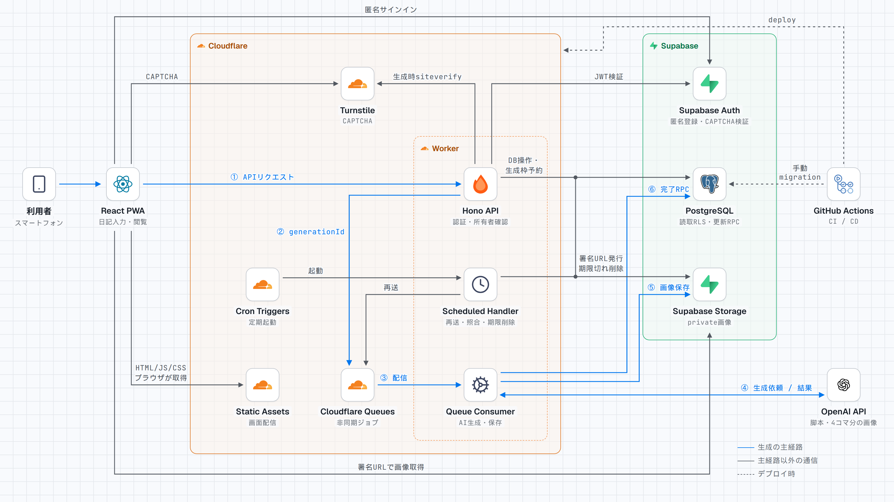

# 漫画日記のアーキテクチャ図



[ライトPNG](architecture.png)／[ダークPNG](architecture-dark.png)／[編集用HTML](architecture.html)

発表で投影できる16:9の図です（PNG：3200×1800）。QueueとOpenAIの実生成を有効にした構成を示します。

- 青い実線：日記から漫画を生成する主経路。番号は処理の順序です
- 灰色の実線：画面取得、認証、読み取り、署名URL、定期処理
- 灰色の破線：デプロイと手動実行のmigration

図は説明用です。構成の正本は`wrangler.jsonc`・`src/server/index.ts`・`src/server/`、操作手順は[OPERATIONS](../OPERATIONS.md)を参照してください。

## 編集と再生成

`architecture.html`が正本です。ロゴと欧文フォントを埋め込んでおり、ネットワークなしで開けます。日本語は端末の日本語フォントで表示します。図中の座標、ラベル、SVGの矢印を編集した後、stack-diagramの公式スクリプトでPNGを書き出します。

```sh
git clone https://github.com/caru-ini/stack-diagram.git /tmp/stack-diagram
git -C /tmp/stack-diagram checkout 1ed53e3e9525364ae5d82e0430f2bb3f7ef4c838
uv run --no-project --with playwright==1.64.1 python -m playwright install chromium
uv run --no-project --with playwright==1.64.1 python \
  /tmp/stack-diagram/skills/stack-diagram/scripts/render_png.py \
  docs/diagrams/architecture.html docs/diagrams/architecture.png \
  --selector .canvas --scale 2
```

ライトとダークの2枚が出力されます。Python3.9以上、uv、Noto Sans CJK JPなどの日本語フォントが必要です。アプリ側の依存関係への追加は不要です。

## 出典とライセンス

- テンプレートと描画：[caru-ini/stack-diagram](https://github.com/caru-ini/stack-diagram/tree/1ed53e3e9525364ae5d82e0430f2bb3f7ef4c838/skills/stack-diagram)、[MITライセンス](licenses/stack-diagram.txt)
- React、Hono、Cloudflare、Supabase、PostgreSQL、OpenAIのロゴ：[svgl](https://svgl.app/)
- GitHub Actionsのロゴ：[gilbarbara/logos](https://github.com/gilbarbara/logos)
- 利用者、Scheduled Handler、Consumerの図記号：[Lucide](https://lucide.dev/)、[ISCライセンス](licenses/lucide.txt)
- 埋め込みフォント：[GeistのOFL](licenses/OFL-Geist.txt)、[JetBrains MonoのOFL](licenses/OFL-JetBrainsMono.txt)

各ロゴの権利は各所有者に帰属します。
